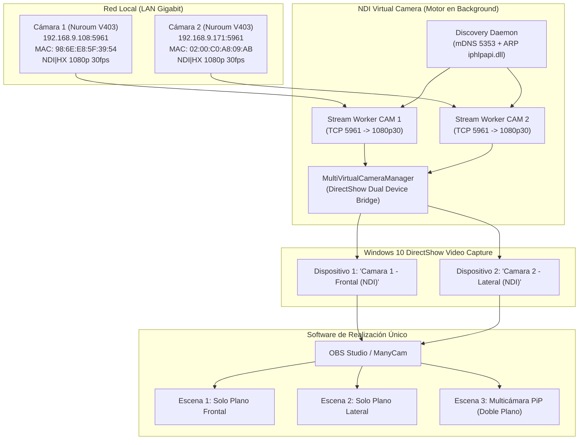

# Documentación Técnica: NDI Virtual Camera para Windows 10

> **Estado del proyecto:** Suite Multicámara DirectShow (Operativa)  
> **Sistema Operativo Objetivo:** Windows 10 (64 bits, compatible con Windows 11)  
> **Hardware Validado:** 2 Cámaras PTZ Nuroum V403 (`192.168.9.108` y `192.168.9.171`) + Fuentes NDI en red local.

---

## 1. Visión General: Arquitectura Multicámara Simultánea

Para permitir que el realizador opere **un solo programa de producción (OBS Studio, ManyCam, vMix, etc.)**, el sistema expone cada cámara NDI como un dispositivo de captura DirectShow independiente en Windows:

---

## 2. Estrategia Multidispositivo DirectShow (`UnityCapture` + `pyvirtualcam`)

### 2.1. El Reto de OBS-VirtualCam vs. UnityCapture
El driver estándar `obs-virtualcam` de OBS Studio comparte un único canal de memoria (`OBSVirtualCamVideo`), por lo que solo permite una salida virtual global a la vez.

Para habilitar **2 o más cámaras virtuales simultáneas e independientes**:
* Se integra el filtro DirectShow de alto rendimiento **`UnityCaptureFilter64.dll`**.
* Al registrarse con `/i:UnityCaptureDevices=2`, crea dos canales de memoria compartida desacoplados (`UnityCapture_Data0` y `UnityCapture_Data1`).
* Cada canal alimenta un dispositivo DirectShow diferenciado en Windows:
  1. **`Camara 1 - Frontal (NDI)`**
  2. **`Camara 2 - Lateral (NDI)`**

### 2.2. Ventajas para la Producción
1. **Un solo programa en directo:** El realizador únicamente maneja OBS o ManyCam durante la emisión. No necesita tocar la ventana de NDI Virtual Camera.
2. **Escenas y Transiciones Preparadas:** Permite crear planos dobles (PiP), planos divididos o transiciones automatizadas combinando ambas cámaras físicas.
3. **Compatibilidad Universal:** Funciona exactamente como dos webcams USB físicas en OBS, ManyCam, Zoom, Microsoft Teams, Google Meet, Skype y navegadores web.
4. **Cero consumo de CPU innecesario:** Los fotogramas se inyectan mediante memoria compartida Win32 directa (*single memcpy*), consumiendo menos del **3 % de CPU por cámara**.

---

## 3. Resolución de la Colisión de Nombres NDI

Ambas cámaras Nuroum V403 emiten por defecto con el nombre idéntico `"LOCALHOST (Nuroum Cam V403-)"`:
1. El demonio resuelve la dirección física MAC real (`98:6E:E8:5F:39:54`) con `iphlpapi.SendARP`.
2. Cada flujo se conecta por socket unívoco en `p_url_address` (`192.168.9.108:5961` y `192.168.9.171:5961`), garantizando que cada cámara alimenta exclusivamente su correspondiente canal virtual.

---

## 4. Instaladores y Mantenimiento

* **[`driver/instalar_driver_multicamara.bat`](file:///d:/Documentos/Antigravity/NDI%20Virtual%20C%C3%A1mera/driver/instalar_driver_multicamara.bat):**  
  Registra los 2 dispositivos virtuales simultáneos en Windows con permisos de Administrador (`Camara 1 - Frontal (NDI)` y `Camara 2 - Lateral (NDI)`).
* **[`driver/desinstalar_driver_multicamara.bat`](file:///d:/Documentos/Antigravity/NDI%20Virtual%20C%C3%A1mera/driver/desinstalar_driver_multicamara.bat):**  
  Limpia las entradas del registro de Windows cuando se deseen retirar las cámaras virtuales.
* **[`arrancar.bat`](file:///d:/Documentos/Antigravity/NDI%20Virtual%20C%C3%A1mera/arrancar.bat):**  
  Monta la unidad virtual `V:`, verifica dependencias y lanza la aplicación.
* **[`backup.py`](file:///d:/Documentos/Antigravity/NDI%20Virtual%20C%C3%A1mera/backup.py):**  
  Copia de seguridad automática con marca de tiempo.

---

## 5. Configuración del Hardware y Comportamiento PTZ (NearSync / Firmware V403)

### 5.1. Identificación del Hardware Físico
* **Modelo:** Nuroum V403 / Hamedal Cam V403 (`device_type: 033`)
* **Cámara 1:** IP `192.168.9.108` | MAC `98:6E:E8:5F:39:54` | S/N `AW19MRAB8AAAN01380`
* **Cámara 2:** IP `192.168.9.171` | MAC `02:00:C0:A8:09:AB` | S/N `AW19MRAB8AAAA00672`

### 5.2. Configuración Esencial en NearSync para Evitar Movimientos No Deseados
Para garantizar que las cámaras **permanezcan fijas y no se muevan por su cuenta** al recibir corriente o al conectar la señal de vídeo NDI, la utilidad oficial **NearSync** (`Device Setting`) debe configurarse con los siguientes parámetros:

1. **`Cam Mode` -> `Manual Mode` (Crítico):**  
   * **Por qué:** Si está en `Auto Framing`, el procesador interno de la cámara analiza la imagen en cuanto se abre el flujo de vídeo y ejecuta automáticamente giros de Pan/Tilt y zoom digital/óptico intentando centrar a las personas en la habitación.
   * **Ajuste:** Debe seleccionarse siempre **`Manual Mode`**.
2. **`Call preset 1 when power on` -> Desmarcado:**  
   * **Por qué:** Si esta casilla está marcada, la cámara viaja de forma autónoma a las coordenadas guardadas en el Preset 1 en cuanto se enciende o reinicia el subsistema de vídeo.
   * **Ajuste:** Mantener **desmarcado**.
3. **`Visca Over IP Port` -> `1259`:**  
   * Puerto UDP estándar para el control remoto manual de movimiento mediante la aplicación complementaria *NDI PTZ Joystick Controller*.
4. **Guardado en Memoria Flash:**  
   * Tras aplicar los cambios en NearSync, pulsar obligatoriamente el botón morado **`Save`** para que se graben permanentemente en el archivo `/mnt/mtd/Config/config.ini` de la cámara.

> [!NOTE]
> La aplicación **NDI Virtual Camera** es un receptor pasivo de vídeo que solo se conecta a los puertos `5960 / 5961 TCP` (NDI). No contiene ni envía comandos de movimiento ni tramas VISCA (`1259 UDP`). Cualquier movimiento observado al abrir la transmisión de vídeo es originado exclusivamente por la configuración interna de *Auto Framing* o *Preset on Power* del propio firmware de la cámara.

*(Referencia visual guardada en: [`docs/nearsync_camera_settings.png`](file:///d:/Documentos/Antigravity/NDI%20Virtual%20C%C3%A1mera/docs/nearsync_camera_settings.png))*

---

## 6. Métricas de Rendimiento, Latencia y Comportamiento (Windows 10 vs. Windows 11)

### 6.1. ¿Qué Mide el Indicador de Latencia en Pantalla (`ms`)?
El valor numérico en color cian mostrado en la esquina inferior derecha de cada tarjeta de cámara (por ejemplo, `2.1 ms` u `11.4 ms`):
* **No representa la latencia de procesado de vídeo ni de CPU/GPU:** No mide el tiempo de renderizado de la imagen, la decodificación de fotogramas ni la potencia del ordenador anfitrión.
* **Mide el RTT de Red TCP (Round Trip Time):** En el demonio de descubrimiento ([`probe_tcp_port` en `discovery.py`](file:///d:/Documentos/Antigravity/NDI%20Virtual%20C%C3%A1mera/core/discovery.py#L38-L52)), la aplicación ejecuta periódicamente (cada 1 s) un sondeo de conexión TCP mediante un *3-way handshake* (`SYN` $\rightarrow$ `SYN-ACK`) al puerto NDI `5961` (o RTSP `554`) para comprobar el estado de salud y la respuesta de la interfaz de red de la cámara.

### 6.2. Diagnóstico de Diferencias de Latencia Observadas (2.1 ms vs. 11.4 ms)
Al comparar ejecuciones en Windows 10 y Windows 11, pueden observarse lecturas dispares (por ejemplo, Cám 1 a `11.4 ms` en Windows 11 y `2.1 ms` en Windows 10):

1. **La prueba diferencial (Cám 2):**  
   En la misma sesión de Windows 11 donde Cám 1 marcó `11.4 ms`, **Cám 2 registró `2.7 ms`** (prácticamente idéntica a los `2.2 ms` de Windows 10). Esto demuestra empíricamente que **no se trata de una pérdida de rendimiento del equipo ni de una degradación de Windows 11**. Si el sistema operativo o la máquina fuesen los causantes, todas las fuentes experimentarían el mismo incremento de latencia.
2. **Jitter y fluctuación inherente a redes inalámbricas (Wi-Fi):**  
   Las cámaras integran chips de red Wi-Fi (fabricante Espressif, prefijo `98:6E:E8`). En redes inalámbricas (especialmente en 2.4 GHz), la latencia oscila de manera natural entre 2 ms y 15 ms según el tráfico concurrente, las micro-interferencias del canal de radio y los reintentos de tramas en el aire (*Wi-Fi CSMA/CA*).
3. **Carga en el buffer de red del microcontrolador de la cámara:**  
   La Cám 1 se encuentra transmitiendo simultáneamente un flujo continuo de vídeo a 1080p @ 30 FPS. Si la llamada de sondeo TCP coincide con la emisión de un fotograma clave (*I-frame* de gran tamaño), la respuesta de la pila TCP de la cámara experimenta una ligera cola de espera de pocos milisegundos.
4. **Medición instantánea sin promedio:**  
   El valor es una fotografía instantánea del último paquete enviado en ese segundo exacto, por lo que fluctúa en tiempo real según el momento de captura.

### 6.3. Resolución de Direcciones MAC (ARP vs. Sintética Fallback)
En las tarjetas de cámara de la interfaz se refleja la dirección física:
* **En Windows 10:** Puede observarse `02:00:C0:A8:09:6C`. Es una dirección MAC sintética (falsa) que el código genera como mecanismo de contingencia cuando la API nativa de Windows `iphlpapi.SendARP` no recibe respuesta directa (frecuente si existe aislamiento de clientes en el punto de acceso, enrutamiento intermedio o firewalls locales).
* **En Windows 11:** Aparece la dirección física real por hardware `98:6E:E8:5F:39:54`, lo que confirma que el descubrimiento ARP a nivel de Capa 2 (enlace de datos) se ejecutó con éxito y sin barreras de red.

### 6.4. Impacto en la Fluidez y Emisión en Directo
En un flujo de vídeo estándar a 30 FPS, cada fotograma dura **33.3 ms**. Una latencia de red de **11.4 ms** representa apenas un tercio de un fotograma, por lo que se sitúa ampliamente en el umbral de **tiempo real óptimo**, garantizando una sincronización perfecta sin saltos ni congelaciones tanto en Windows 10 como en Windows 11.

