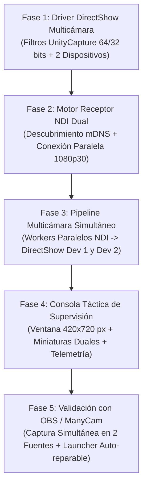

# Plan de Trabajo: NDI Virtual Camera para Windows 10

> **Objetivo:** Construir una solución completa, robusta y portable para Windows 10 que reciba flujos de vídeo NDI (cámaras Nuroum V403 y otras fuentes), permita exponerlas como **múltiples dispositivos de Cámara Virtual DirectShow independientes y simultáneos** para OBS Studio, ManyCam, Zoom, Teams, Meet, etc.

---

## Fases de Desarrollo

---

### FASE 1: Driver DirectShow Multicámara (`driver/`)
* [x] **1.1. Integración de `UnityCaptureFilter64.dll` y `UnityCaptureFilter32.dll`:**
  * Soporte de memoria compartida dual (`UnityCapture_Data0` y `UnityCapture_Data1`).
* [x] **1.2. Script `instalar_driver_multicamara.bat`:**
  * Auto-elevación a Administrador para registrar 2 dispositivos simultáneos:
    * `NDI Camara 1`
    * `NDI Camara 2`
* [x] **1.3. Script `desinstalar_driver_multicamara.bat`:**
  * Limpieza del registro para retirar los dispositivos virtuales cuando sea necesario.

---

### FASE 2: Ingesta NDI Paralela (`core/`)
* [x] **2.1. Resolución de Nombres Duplicados (`core/discovery.py`):**
  * Asignación por hardware MAC (`iphlpapi.SendARP`) para diferenciar las dos cámaras Nuroum V403.
* [x] **2.2. Workers de Ingesta NDI en Hilos Independientes (`core/video_pipeline.py`):**
  * Hilo A: `<IP_CAM_1>:5961` $\rightarrow$ Ingesta 1080p30 Full HD.
  * Hilo B: `<IP_CAM_2>:5961` $\rightarrow$ Ingesta 1080p30 Full HD.

---

### FASE 3: Pipeline a DirectShow Multidispositivo (`core/virtual_cam.py`)
* [x] **3.1. Gestor Multidispositivo (`VirtualCameraManager`):**
  * Alimenta simultáneamente ambos canales de captura sin colisión de memoria compartida.
* [x] **3.2. Tarjeta Standby Independiente por Canal:**
  * Si una cámara pierde conexión de red, su canal virtual específico emite la placa táctica de espera, mientras el otro canal continúa emitiendo con total normalidad.

---

### FASE 4: Consola de Supervisión Táctica (`ui/`)
* [x] **4.1. Ventana Optimizada (420 × 720 px, `resizable: true`):**
  * Ajuste de altura para mostrar ambas tarjetas de cámara completas y holgadas sin cortes verticales.
* [x] **4.2. Miniaturas Duales en Tiempo Real:**
  * Previsualización continua a 10 fps con consumo de CPU < 2%.
* [x] **4.3. Internacionalización (i18n):**
  * Selector rápido Español (`SP`) / Inglés (`EN`) en [`ui/i18n.js`](file:///d:/Documentos/Antigravity/NDI%20Virtual%20C%C3%A1mera/ui/i18n.js).

---

### FASE 5: Empaquetado y Portabilidad
* [x] **5.1. Launcher Auto-Reparable (`arrancar.bat`):**
  * Mapeo `subst V:`, verificación de entorno virtual y comprobación de DirectShow.
* [x] **5.2. Sistema de Respaldo (`backup.py`):**
  * Copias de seguridad automáticas con exclusión de `venv`.
