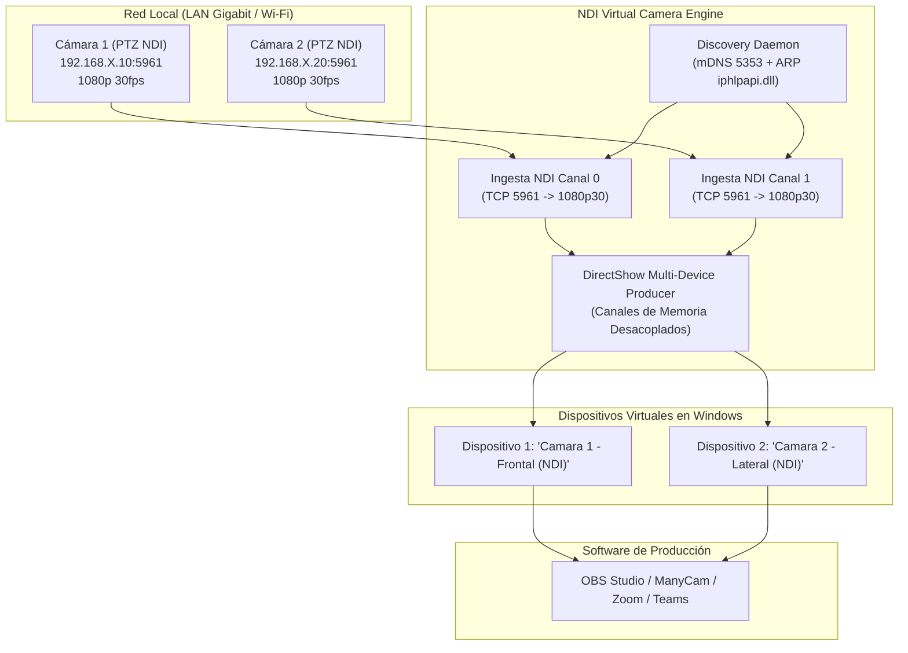

# NDI Multicam Virtual Camera (Windows 10 / 11)

> ⚠️ **AVISO IMPORTANTE / ARCHIVED & REFERENCE REPOSITORY (AS-IS)**  
> Este proyecto se publica de forma pública y abierta exclusivamente como **código de referencia técnica y prueba de concepto**.  
> **NO SE OFRECE SOPORTE TÉCNICO NI MANTENIMIENTO ACTIVO.**  
> * No se atenderán incidencias (*Issues*), dudas de configuración de red ni solicitudes de compatibilidad para otros modelos de cámara o hardware.  
> * El software se proporciona "tal cual" (*AS-IS*), sin garantías de funcionamiento en entornos distintos al probado.  
> * Eres libre de hacer un *fork* del repositorio y adaptar el código a tu propio flujo de trabajo.

---

## 📌 ¿Qué problema resuelve este proyecto?

1. **Limitación de Cámara Virtual Única en Windows:**  
   Las herramientas oficiales de NDI y los drivers estándar (`obs-virtualcam`) solo permiten emitir una única cámara virtual global a la vez. Este proyecto integra un motor de memoria compartida desacoplada basado en DirectShow (`UnityCapture`) que expone **múltiples cámaras NDI simultáneas e independientes en Windows** (`Cámara 1 - Frontal`, `Cámara 2 - Lateral`, etc.) para consumirlas simultáneamente en OBS Studio, ManyCam, vMix, Zoom o Teams.

2. **Colisión de Nombres NDI Duplicados:**  
   Resuelve el problema de cámaras NDI de bajo coste (como las *Nuroum V403* / *Hamedal*) que emiten por defecto con el nombre idéntico `LOCALHOST (Nuroum Cam V403-)`. El sistema resuelve la dirección física MAC real (`iphlpapi.SendARP`) a nivel de Capa 2 y asocia cada flujo NDI por socket y puerto exacto (`<IP_CAM_1>:5961`, `<IP_CAM_2>:5961`), garantizando que cada cámara alimenta su canal virtual sin mezclas.

3. **Ingesta Híbrida Dinámica (NDI 1080p vs RTSP 720p):**  
   Permite seleccionar individualmente para cada cámara su protocolo de captura. El modo RTSP HD (1280x720 @ 25 FPS) aprovecha el flujo secundario nativo del sensor de la cámara en origen, reduciendo en un 55,6% el volumen de píxeles procesados por segundo para garantizar fluidez total en ordenadores con procesadores moderados (ej. AMD Ryzen 5, mini-PCs Intel N100) sin perder calidad DirectShow. Conmutación en caliente (*hot-switching*) sin reiniciar la app.

4. **Grabación Dual Simultánea MKV (Hardware Accelerated):**  
   Grabador integrado que emite y almacena simultáneamente ambas señales en ficheros Matroska MKV con detección automática de aceleradores de hardware (`h264_nvenc` de NVIDIA, `h264_qsv` de Intel, `h264_amf` de AMD o `libx264 ultrafast` por CPU). Los ficheros son inmunes a cortes eléctricos y no degradan la entrega a la cámara virtual.

5. **Ciclo de Vida Blindado y Desbloqueo de Drivers:**  
   Protocolo de arranque preventivo contra instancias zombies anteriores (con reasignación de puerto anti-pantalla blanca) y cierre atómico ordenado que descarga inmediatamente las librerías DirectShow (`UnityCaptureFilter64.dll`), evitando el típico problema de Windows donde los archivos quedan bloqueados hasta reiniciar el PC.

6. **Arquitectura y Distribución Portable:**  
   * **Entorno de desarrollo Python:** Servidor HTTP táctico local + GUI en PyWebView (`arrancar.bat`).
   * **Suite Portable Lista para Usar:** Paquete empaquetado en [`dist_portable/`](file:///dist_portable/) con ejecutable autónomo (`NDI Virtual Camera.exe`), dependencias NDI y FFmpeg integradas, y paquete comprimido `.zip` listo para pendrive.

---

## 🏗️ Arquitectura del Sistema

---

## 🚀 Uso Rápido (Suite Portable Nativa)

La carpeta [`dist_portable/`](file:///dist_portable/) contiene la distribución lista para copiar en un pendrive y usar en cualquier PC con Windows 10 u 11 sin instalar nada:

1. **Instalar el Driver Multicámara (Solo la primera vez):**  
   Entra en `dist_portable/driver/`, haz clic derecho en **`instalar_driver_multicamara.bat`** y selecciona **Ejecutar como Administrador**.  
   Esto registrará los dos canales DirectShow en Windows.
2. **Lanzar la Aplicación:**  
   Ejecuta **`NDI-Virtual-Camera.exe`**.  
   El programa detectará automáticamente las cámaras NDI en la red local y comenzará a alimentar los dispositivos virtuales.
3. **Seleccionar en OBS / ManyCam:**  
   Añade dos fuentes de vídeo "*Dispositivo de captura de vídeo*" y elige `Camara 1 - Frontal (NDI)` y `Camara 2 - Lateral (NDI)`.

---

## 🛠️ Desarrollo y Compilación

* **Versión Python:** Ejecuta [`arrancar.bat`](file:///arrancar.bat) (crea y gestiona el entorno virtual en `core/venv` automáticamente).
* **Compilación Nativa Rust / Tauri v2:** Ejecuta [`compilar_y_empaquetar.bat`](file:///compilar_y_empaquetar.bat) para compilar en modo Release y generar la distribución portable.
* **Documentación Completa:** Consulta [`DOCUMENTACION.md`](file:///DOCUMENTACION.md) para detalles sobre latencias TCP, resolución MAC y configuraciones de firmware.

---

## 📄 Licencia

Este proyecto se distribuye bajo la licencia **MIT**. Consulta el archivo `LICENSE` para más detalles.
